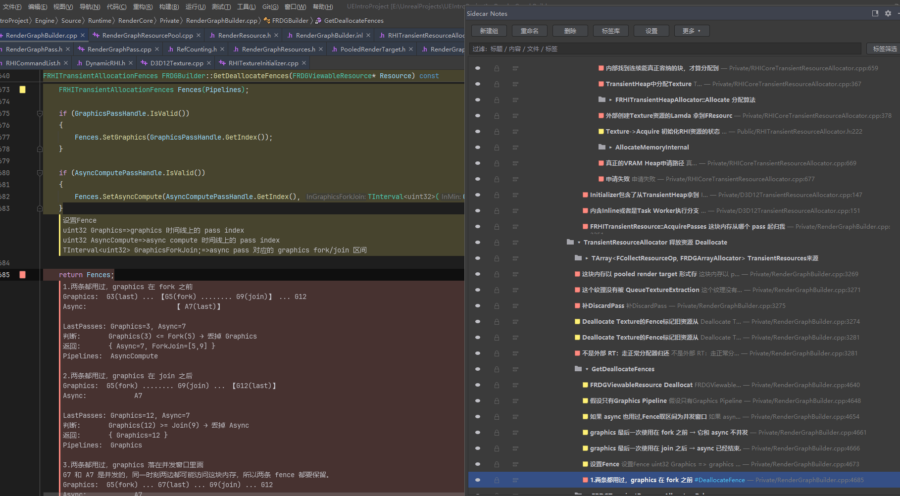

# Sidecar Notes（侧挂笔记）




> 仓库目录名仍为 `RiderNotes`；插件在 IDE 与 Marketplace 上显示为 **Sidecar Notes**
> （JetBrains 自 2024-03 起禁止插件名包含 "Rider"，`verifyPlugin` 会直接判为无效）。

给代码区间挂「侧挂笔记」的 Rider 插件：**一个字节都不写进源文件**，笔记存在项目里的独立 JSON 分片中。

- 目标宿主：JetBrains Rider 2026.2.3.1（`262.10968.170`，`since-build=262`）
- 当前版本：`0.47.3`（变更记录见 [CHANGELOG.md](CHANGELOG.md)）
- 实现参考：[docs/ridenotes-design-v1.md](docs/ridenotes-design-v1.md)

---

## 能做什么

| 能力 | 说明 |
|---|---|
| 代码区间锚点 | 选中一段代码 → `Ctrl+Alt+N` 建笔记；区间用颜色带标出 |
| 一条锚点多条笔记 | 追加/编辑/删除单条笔记，最新在前 |
| 编辑器内摘要块 | 锚点下方一个块，显示标题 + 每条笔记（首行右侧右对齐时间） |
| 就地编辑 | 双击摘要块，浮层直接盖在块上编辑，`Ctrl+Enter` 保存 / `Esc` 取消 |
| 分组树面板 | 分组可嵌套、拖拽排序、显示/锁定/简洁三个开关、颜色可覆盖 |
| 标签库 | 标签分组管理、颜色、勾选式打标签、拖拽归组与排序 |
| **筛选与搜索** | 顶部过滤框匹配标题/正文/文件/标签；标签多选筛选 |
| **撤销** | 笔记增删改、颜色、开关、重命名、标签、删除都支持 `Ctrl+Z` |
| **锁定** | 锁定后编辑器与面板都禁止编辑/删除 |
| **过期提示** | 代码变了只标 `⚠已变更`，**不移动、不消失** |
| **本地 HTTP 接口** | 脚本化批量建笔记 / 压测（`127.0.0.1:47800`），见 [docs/ai-cli.md](docs/ai-cli.md) |
| **多语言** | 英文（默认）/ 简体中文，跟随 IDE 语言 |

---

## 给 AI / 脚本用（可选）

侧挂笔记提供一个本地 HTTP 接口，让脚本或 AI agent 能给代码挂笔记、改笔记，而不用模拟 UI。

1. 打开 **Sidecar Notes 面板 → 设置**，勾选「启用本地 HTTP 接口」→ 确定
2. 插件会在项目里生成能力文件：

   ```jsonc
   // <项目根>/.ridenotes/api.json
   { "port": 47800, "token": "a1b2c3…", "version": "0.53.0", "project": "ConsoleApp1" }
   ```

   同目录的 `.gitignore` 会排除它，**令牌不会被提交**
3. 对 AI 说一句即可：

   > 读取项目里的 `.ridenotes/api.json`，用里面的 port 和 token 调用 Sidecar Notes 接口，
   > 协议见 docs/ai-cli.md。

**默认关闭**——不开就不监听端口，普通用户完全无感。完整协议见 **[docs/ai-cli.md](docs/ai-cli.md)**。

---

## 安装

```powershell
# 1. 构建
$env:JAVA_HOME='C:\Program Files\Microsoft\jdk-25.0.3.9-hotspot'
.\gradlew.bat buildPlugin --console=plain

# 2. 装进日常 Rider（替换旧版本）
$plugins = "$env:APPDATA\JetBrains\Rider2026.2\plugins"
Get-ChildItem $plugins -Directory | Where-Object { $_.Name -like 'RiderNotes*' } | Remove-Item -Recurse -Force
Expand-Archive build\distributions\RiderNotes-0.47.3.zip -DestinationPath $plugins -Force
```

重启 Rider 生效。日志在 `%LOCALAPPDATA%\JetBrains\Rider2026.2\log\idea.log`，插件日志前缀 `[RN]`。

卸载：删掉 `%APPDATA%\JetBrains\Rider2026.2\plugins\RiderNotes`。

`gradle.properties` 里的 `riderHome` 指向本机 Rider 安装目录，换机器改这一行。

---

## 用法

### 建笔记

1. 在编辑器里选中一段代码（纯空白选区会被拒绝）
2. `Ctrl+Alt+N`
3. 输入内容，`Ctrl+Enter` 保存

### 编辑器内

| 操作 | 效果 |
|---|---|
| 单击摘要块 | 光标移到锚点起始行 |
| 双击摘要块 | 就地编辑该锚点最新一条笔记 |
| 点 gutter 图标 | 直接进入就地编辑 |
| 摘要块左侧 3px 竖条 | 该锚点的颜色（不透明饱和色） |
| 摘要块填充 | 同色相低饱和（alpha 46），保证正文可读 |
| 每条笔记首行右侧 | `MM-dd HH:mm` 时间，右对齐 |

### Notes 面板（右侧工具窗口）

| 操作 | 效果 |
|---|---|
| 双击分组行 | 展开/折叠 |
| 双击笔记行 | 跳到代码 **并** 展开该锚点的子笔记（多条时） |
| 点 `▾/▸` | 只展开/折叠子笔记，不跳转 |
| 双击子笔记 | 弹框编辑那条笔记 |
| `F2` | 重命名 |
| `Delete` | 删除选中项（支持多选批量） |
| 拖拽 | 拖进分组 / 拖到行前 / 拖到行后（有蓝线指示） |
| 右键 | 颜色、追加笔记、添加标签、重新定位、重新绑定、删除 |
| 顶部过滤框 | 输入即过滤：标题 / 正文 / 文件路径 / 标签 |
| 「标签筛选」 | 按标签库多选筛选，命中任一即保留 |
| 「清理归属」 | 手动清理索引中指向已删除锚点的归属记录（会确认） |
| 「更多 ▾」 | 刷新、清理归属、**从 IDE 书签导入**、导出 Markdown / PR 评论 |

三列开关分别是：**显示**（不渲染）、**锁定**（禁止改）、**简洁**（每条笔记压成一行）。

### 标签

- 工具栏「标签库」：树形结构 `分组 → 标签`，可新建/重命名/删除，拖拽归组与排序，`F2` 或双击重命名
- 右键任意节点 →「添加标签…」→ 按分组勾选，再点一次取消
- 标签是**结构化字段**（`Note.tags` / `GroupNode.tags`），不会写进笔记正文

---

## 数据放在哪

```
<项目根>/.ridenotes/
  ├── _project.json                         # 分组树 + 归属 + 标签库
  └── Source__Foo__Bar.cpp.notes.json       # 每个源文件一个分片
```

- 源文件路径转义为 `__` 分隔
- 写入走临时文件 + 原子替换
- **提交到 git 即可团队共享**

`_project.json` 结构：

```jsonc
{
  "schema": 1,
  "groups":   [{ "id", "title", "color", "visible", "parentId", "order", "locked", "compact", "tags" }],
  "placements": [{ "anchorId", "groupId", "visible", "order", "locked", "compact", "colorOverride" }],
  "tags":     [{ "id", "name", "color", "groupId" }],
  "tagGroups":[{ "id", "name", "order" }]
}
```

分片结构：

```jsonc
{
  "schema": 1,
  "file": "相对路径",
  "anchors": [{
    "id", "startOffset", "endOffset", "startLine", "endLine",
    "anchorText", "anchorSha1", "contextBefore", "contextAfter",
    "title", "color", "createdAt", "updatedAt",
    "notes": [{ "id", "body", "author", "createdAt", "updatedAt", "tags": [] }]
  }]
}
```

---

## 锚定模型（重要）

**按行号锚定，书签语义**：

| 时机 | 行为 |
|---|---|
| 会话内 | `RangeMarker` 跟随编辑，行号实时更新 |
| 跨会话打开 | 认存储的 `startLine/endLine`，夹到文件范围内 |
| 原文对不上 | 只标 `⚠已变更`，**笔记留在原位**，不搜索、不移动 |
| 想找回来 | 右键 →「尝试重新定位」（搜一次，弹确认）或「重新绑定到当前选区」 |

代价：在锚点上方插入/删除行，跨会话会整体偏移（与 Rider 自带书签一致）。会话内不会。

---

## 设置

入口：**Notes 面板工具栏的「设置」按钮**（未注册到 IDE 的 Settings 树，当前是插件自己的对话框）。

存储：`riderNotes.xml`（应用级，所有项目共用）：

- 字体 / 字号（留空则跟随 IDE 标签字体）
- **摘要最大宽度：`0` = 跟随窗口（贴右边缘）；> 0 作为上限**
- 在编辑器中显示摘要块（关掉后只保留色带和 gutter 图标）
- 笔记库目录（项目级，存 `.idea/ridenotes.xml`）

---

## 本地 HTTP 接口（自动化 / 压测 / AI）

项目打开后监听 `127.0.0.1:47800`（端口可配置，被占用会顺延）。除 `/ping` 外所有请求需带
`X-Sidecar-Token` 请求头，令牌在设置对话框里生成。

完整协议、示例与缺口清单见 **[docs/ai-cli.md](docs/ai-cli.md)**。摘要：

| 方法 | 路径 | 说明 |
|---|---|---|
| GET | `/status` | 项目 / 库路径 / 版本 / 锚点数 / 笔记数 |
| GET | `/anchors?file=&q=` | 列出或按文本搜索锚点 |
| POST | `/anchors` | 建一条 |
| POST | `/anchors/batch` | 批量建（0.3 ms/条） |
| POST | `/anchors/update` | 改标题 / 颜色 / 显示 / 锁定 / 简洁 |
| POST | `/notes` | 给已有锚点追加笔记 |
| POST | `/notes/update` | 改笔记正文 / 标签 |
| POST | `/notes/delete` | 删除单条笔记 |
| POST | `/batch` | 混合批量操作（一次写盘、一次重绘） |
| GET | `/changes?since=` | 增量比对：返回变化的文件 |
| GET | `/export?format=md\|pr` | 导出 Markdown / PR 评论 |
| POST | `/anchors/delete` | 按 id 删除锚点 |
| POST | `/clear` | 清空文件或整库 |

调用方可带 `X-Sidecar-Client: my-agent/1.0` 标识来源（写入笔记作者，便于审计）。

实测：批量导入 1000 条约 0.3 ms/条；单条追加在 1000 锚点下约 60 ms（渲染 16 ms），5000 锚点约 170 ms。

---

## 已知限制

- **Diff 视图内不显示**锚点
- **真·就地文本编辑不可行**：摘要块是 inlay，编辑用的是盖在上面的浮层（视觉上等同）
- 折叠区间内的锚点不可见
- **拖拽排序、标签库对话框内的改动**暂不支持 `Ctrl+Z`
- HTTP 接口需携带访问令牌（可在设置里关闭接口或重新生成令牌）
- 「清理归属」是手动操作，不会自动执行（避免分片临时读失败时误删归属）

---

## 路线图

- [ ] HTTP 接口加 token / 设置开关（发布前）
- [ ] 拖拽排序、标签库改动的撤销
- [ ] 面板跟随光标
- [ ] 作者名取 `git config user.name`
- [ ] 导出 Markdown / PR 评论
- [ ] 浅色主题、HiDPI、IME 输入验证
- [ ] 大文件打开时的后台分片预取

---

## 开发

| 项 | 版本 |
|---|---|
| Rider | 2026.2.3.1（`262.10968.170`） |
| JDK | 25（`C:\Program Files\Microsoft\jdk-25.0.3.9-hotspot`） |
| Gradle | 9.9.0（wrapper 已带） |
| Kotlin | 2.4.21 |
| IntelliJ Platform Gradle Plugin | 2.20.0 |

```bash
./gradlew buildPlugin   # 产物 build/distributions/RiderNotes-<version>.zip
./gradlew runIde        # 沙箱实例，日志在 .intellijPlatform/sandbox/.../log_runIde/idea.log
```

### 结构

```
model/      Anchor / Note / GroupNode / Placement / TagDef、Anchoring、AnchorStore
service/    NoteAnchorService（缓存、持久化、分组、标签、快照恢复）
editor/     AnchorRenderService（色带、gutter、摘要块、就地编辑）
ui/         NotesPanel、TagLibraryDialog、NotesSettingsDialog、NotePopups
actions/    CreateAnchor / DeleteAnchor / Refresh / Toggle*、registerUndo
settings/   NotesSettings（全局持久化）
```

`docs/ridenotes-design-v1.md` 里有实现时踩到的平台坑（贪婪标志、inlay 不跟随、JTree/JTable 绘制等），改渲染相关代码前先看。
